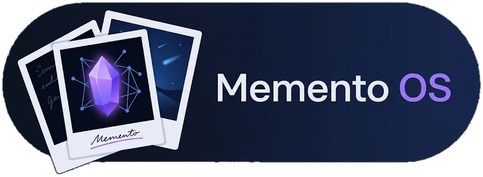
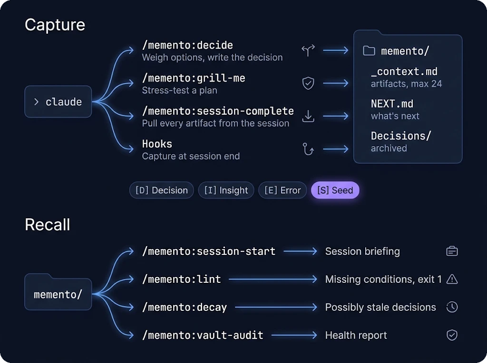

<p align="center">
  
</p>

<h3 align="center">Store conclusions, not notes.</h3>

<p align="center">
  <em>Unlike the guy in Memento, your AI actually remembers correctly — and knows when to forget.</em>
</p>

<p align="center">
  
</p>

<p align="center">
  <a href="https://github.com/Aiyo28/memento-os/actions/workflows/ci.yml"></a>
  <a href="LICENSE"></a>
</p>

<p align="center">
  <a href="#install">Install</a> · <a href="#how-it-works">How It Works</a> · <a href="#reasoning-artifacts">Artifacts</a> · <a href="#works-with">Multi-AI</a> · <a href="#known-limitations">Limitations</a>
</p>

---

Memento OS gives Claude Code, Codex and Cursor a memory between sessions: it saves your decisions, each with the condition that makes it wrong.

Most second-brain and memory setups save more: transcripts, notes, everything you said. A few months in, the vault is full and your agent still asks why you picked Supabase, or keeps trusting a choice that stopped being true. Memento saves less. Each entry is one conclusion and the condition that ends it:

```
[D] Use Supabase over Firebase — invalidates if Firebase adds RLS   [critical]
```

- **Your agent starts from your decisions, not your chat log.** `/memento:recall` briefs it from `_context.md`, capped at 24 artifacts, for about 620 tokens a session.
- **Old decisions don't go stale quietly.** `/memento:forget` finds decisions whose condition may have fired. `/memento:check` fails any decision saved without one.
- **Nothing to migrate.** It's plain markdown, in your project or the Obsidian vault you already use.

New to this? You don't need a vault or a system first. `/memento:init` asks for the hardest decision you've made so far and saves it as your first artifact. The memory grows from there.

## The Problem

AI agents are stateless. Every session starts from zero.

- Decisions discussed → **gone when the session ends**
- Context compressed → **compaction kills memory**
- Research done once → **invisible next session**
- "We chose Supabase" → **nobody remembers why, or when that stops being true**

## Install

One command in your terminal:

```bash
claude plugin marketplace add Aiyo28/memento-os && claude plugin install memento@aiyo
```

It takes about 4 seconds. Or inside Claude Code:

```bash
/plugin marketplace add Aiyo28/memento-os
/plugin install memento@aiyo
```

Then, in each project where you want memory:

```bash
/memento:init
```

It asks where to keep memory, what you're building, and the hardest decision you've made so far. That decision becomes your first `[D]` artifact.

Already installed? `claude plugin update memento@aiyo`. Updating the marketplace on its own doesn't update an installed plugin.

Coming from 2.x? The plugin was renamed from `memento-os` to `memento`, so `update` can't find it: run `claude plugin uninstall memento-os@aiyo`, then the install command above. Five commands were renamed too: `session-complete` is now `end`, `session-start` is `recall`, `decay` is `forget`, `lint` is `check` and `vault-audit` is `audit`. The old names no longer work.

Codex, Cursor and the other tools: see [Works With](#works-with).

## How It Works

<p align="center">
  
</p>

<p align="center">
  
</p>

7 skills. One loop: decide, remember, forget.

| Loop | Skill | What it does |
|------|-------|-------------|
| **Decide** | `/memento:grill-me` | Stress-test your plan across 6 dimensions |
| | `/memento:decide` | OODA loop → `[D]` artifacts or `[S]` seeds |
| **Remember** | `/memento:end` | Save the session's artifacts to `_context.md`, update `NEXT.md`, then run check on what it wrote |
| | `/memento:recall` | Load context, surface decisions, check seeds |
| | `/memento:check` | Check every artifact against the schema rules; non-zero exit for hooks and CI |
| **Forget** | `/memento:forget` | Find aged `[D]` artifacts whose invalidation triggers may have fired |
| | `/memento:audit` | Health check, staleness scan, inbox processing; runs forget |

**Hooks** run automatically. **Stop and PreCompact stay silent until you run `/memento:init`** in a project; an uninitialized project is never written to. `touch .memento-skip` in any project where you never want Memento.

<a id="what-the-hooks-do"></a>
**What the hooks do.** All three are `type: command` hooks: `hooks/hooks.json` runs `hooks/memento_hook.py` with `python3`. The script reads local files only. It writes no files, makes no network calls and sends no telemetry.

| Hook | When | Reads | Writes |
|------|------|-------|--------|
| SessionStart | A new session starts | Whether `_context.md` exists (project root, `./memento/`, or the path in `.memento/config.yaml`) and whether `.memento-skip` exists | Nothing. Prints one line if the project isn't initialized |
| Stop | Claude finishes a turn | Claude's last reply; `_context.md` and the `Decisions/` folder beside it | Nothing. If the reply states a `[D]`/`[I]`/`[E]`/`[S]` artifact that isn't saved there, Claude is asked once to add it to `_context.md` or say why not |
| PreCompact | Before context compaction | Where `_context.md` is | Nothing. Tells the compaction summary to keep unsaved artifacts word for word |

The hooks never write files. When Stop finds an unsaved artifact, Claude adds it to `_context.md` or says why not before the turn ends, without asking you; Stop asks at most once per turn and never asks for a session log. Nothing is written outside an initialized project.

**Commands:** `/memento:init` (setup) · `/memento:stats` (memory score + streaks)

## Reasoning Artifacts

The atomic unit. Not a note — a pre-computed conclusion with an expiration condition.

```
[D] Use Supabase over Firebase — invalidates if Firebase adds RLS            [critical]
[I] MV3 service workers die after 30s — invalidates if Chrome changes policy [settled]
[E] Deployed without testing webhooks — root cause: no staging env — fix: added pre-deploy checklist [settled]
[S] Consider caching layer — activates when: API p95 > 200ms                [volatile]
```

| Prefix | Type | Purpose |
|--------|------|---------|
| `[D]` | Decision | Choice between alternatives — has invalidation trigger |
| `[I]` | Insight | Reusable conclusion — survives the session that produced it |
| `[E]` | Error | Mistake with root cause + fix — drops to noise once learning extracted |
| `[S]` | Seed | Forward-looking idea — activates when conditions are met |

### Priority Matrix

Confidence (Claude proposes) × Impact (you confirm):

|  | High Impact | Low Impact |
|---|---|---|
| **High Confidence** | **critical** — pinned | **settled** — evict first |
| **Medium** | **volatile** — needs resolution | **settled** |
| **Low Confidence** | **volatile** | **noise** — discard |

Cap: 24 artifacts per context. Eviction: noise → settled → volatile → critical (never).

## Works With

Same vault, same artifacts, different integration depth.

| Tool | Tier | Install |
|------|------|---------|
| **Claude Code** | Full Plugin — 7 skills, 3 hooks, 2 commands | `/plugin marketplace add Aiyo28/memento-os` → `/plugin install memento@aiyo` |
| **Agent Skills** (50+ hosts) | Skills — auto-discovers all `skills/**` | `npx skills add Aiyo28/memento-os -g` (manual `npx skills update`) |
| **Codex** (OpenAI) | Full Skills — AGENTS.md + 7 skills | [adapters/codex/](adapters/codex/) |
| **Cursor** | Rules — conventions + workflow | [adapters/cursor/](adapters/cursor/) |
| **Windsurf** | Rules | [adapters/windsurf/](adapters/windsurf/) |
| **Cline** | Rules | [adapters/cline/](adapters/cline/) |
| **Gemini** | Rules — GEMINI.md | [adapters/gemini/](adapters/gemini/) |
| **Aider** | Manual — CONVENTIONS.md | [adapters/aider/](adapters/aider/) |
| **Continue** | Manual — config snippet | [adapters/continue/](adapters/continue/) |

## Obsidian

Memory is plain markdown. Point [Obsidian](https://obsidian.md) at your vault for graph view, backlinks, and search.

```
knowledge-vault/
├── Projects/
│   ├── _context.md          # Cross-project decisions
│   └── my-app/
│       ├── _context.md      # Project artifacts (the brain)
│       ├── NEXT.md          # Session continuity
│       └── Decisions/       # Full decision records
├── Personal/
│   └── _context.md          # Hobbies, health, learning artifacts
├── Business/
│   └── _context.md          # Cross-business decisions
├── Knowledge/
│   ├── _context.md          # General cross-domain insights
│   └── MOC — Patterns.md    # Map of Content hubs
├── People/
│   └── Self.md              # Your peer card
└── _meta/
    └── conventions.md       # Vault rules
```

Every area has its own `_context.md` with an artifacts table. Artifacts route automatically to the right context based on domain. Tags: `tech/`, `business/`, `product/`, `ai/`, `personal/` — nested as `domain/subtopic`. Folders created on demand.

## Before / After (example)

**Without** (session 5):
```
> What auth approach did we decide on?
I don't have context on previous decisions. Could you remind me?
```

**With** (session 5):
```
## Session Briefing — My Project
Memory: 6.8/10 | 14 artifacts | 2 seeds | streak: 5

### Active Decisions
[D] OAuth via Supabase Auth — invalidates if rate limits hit [critical]
[D] Mobile-first, no desktop v1 — invalidates if desktop demand >30% [critical]

### Seeds Ready
[S] Consider Redis caching — activates when: API p95 > 200ms ← CONDITION MET
```

## Known Limitations

- **Stop reads only Claude's last reply.** It catches artifacts that carry their trigger clause (`invalidates if`, `activates when`, `fix:`) and are missing from `_context.md`. An artifact stated earlier in the turn is not seen, and one saved in other words is flagged once. Claude does the writing, so `/memento:check` is still the check on the result.
- **PreCompact writes nothing.** It asks the compaction summary to carry unsaved artifacts word for word; they reach `_context.md` only when Claude saves them after compaction. It does not update `NEXT.md`, and open files, task lists and half-finished reasoning are still lost to compaction.
- **Tests cover `check`, `forget` and the hook script.** `tests/run.sh` runs 65 assertions against fixture vaults and hook inputs. The skills are prompts and have no automated tests.
- **`forget` is a heuristic.** It matches words from each invalidation trigger against git history and newer artifacts. It suggests candidates; you confirm each one.
- **The hooks are Claude Code only, and need `python3`.** In Codex the skills run when you ask for them. Cursor, Windsurf, Cline and Gemini get rules the model reads on every run. With Aider and Continue you run the workflows yourself, and vault sync is manual.
- **Updates are manual.** Run `claude plugin update memento@aiyo` (or `npx skills update`). Two installed versions can both fire their hooks in one session; it happened here with 2.3.2 and 2.3.3.
- **It costs context.** About 620 tokens are added to every session, plus 600 to 1,400 each time a skill runs (estimates from `claude plugin details memento@aiyo`).

## How It Started

I kept reaching the same conclusions across sessions — same reasoning, same answer, different day. The vault was full of notes, but the actual decisions were buried in noise.

So I flipped it: capture *only* conclusions. Each one with a condition that makes it invalid — so the system knows when to question itself instead of blindly trusting old decisions.

That shift, from saving everything to saving only conclusions, turned out to be the entire product. I still keep my own projects' decisions in this format. Memento OS packages it as a plugin anyone can install.

<details>
<summary><strong>Design decisions</strong> — how we got here, failure by failure</summary>

| ADR | Decision |
|-----|----------|
| [0001](docs/adr/0001-tiered-context.md) | Tiered context loading |
| [0002](docs/adr/0002-safety-hooks.md) | Safety hooks |
| [0003](docs/adr/0003-vault-bridge.md) | Vault bridge |
| [0004](docs/adr/0004-cross-project-linking.md) | Cross-project linking |
| [0005](docs/adr/0005-scattered-captures.md) | Scattered captures |
| [0006](docs/adr/0006-decision-rot.md) | Decision rot |
| [0007](docs/adr/0007-compaction-loss.md) | Compaction loss |
| [0008](docs/adr/0008-write-discipline.md) | Write discipline |

Terms are defined in [docs/GLOSSARY.md](docs/GLOSSARY.md).

</details>

## Acknowledgments

The `/memento:grill-me` skill is based on [Matt Pocock](https://github.com/mattpocock)'s grill-me prompt, adapted for the Memento OS artifact system. If you like what it does, check out his repos — there's more where that came from.

## Contributing

Welcome: ADRs, adapter improvements, scorecard improvements, translations.

Not accepted: vendor plugins, paid integrations, AI-generated filler.

## License and Support

[MIT](LICENSE), all of it.

If Memento OS saved you time, you can buy me a coffee.

[](https://paypal.me/aiyo28)
[](https://ko-fi.com/aiyo1939)

Any amount, any currency.

Author: [Ayal Nogovitsyn](https://github.com/Aiyo28), based in Kazakhstan.
