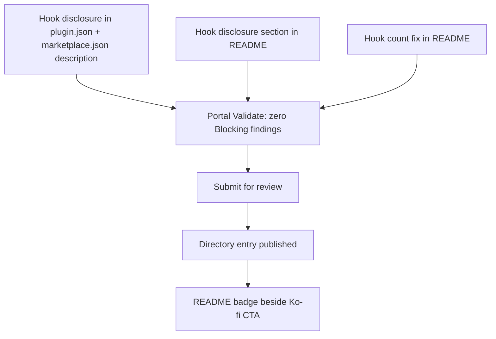

## Problem Statement

Anthropic opened a plugin directory (claude.ai/directory/manage, 2026-09-25). Memento OS is already a Claude Code **Plugin** installed through its own marketplace (`/plugin marketplace add Aiyo28/memento-os`), and `claude plugin validate` passes. Two gaps remain before a **Directory entry**:
1. The security scan looks for *undisclosed* behavior. The Stop and PreCompact **Hooks** write files without asking (by design), but the README only says they "capture artifacts" and doesn't name the files.
2. ~~No donation CTA~~ — corrected 2026-09-28: the README already has a Ko-fi CTA under `## Support`, which satisfies `[D]#26` (any platform). No change needed.

The README also says "2 hooks", but `hooks/hooks.json` defines 3 (SessionStart, Stop, PreCompact).

3. **The review is judged on the `plugin.json` description, not only the README.** Anthropic's curated-marketplace review prompt (`anthropics/claude-plugins-official/.github/policy/prompt.md`) fails a plugin when `description_matches_behavior=false`: *"would a user reading only the install description be surprised by what you found?"* The current description ("Decision-centric memory system… OODA-driven reasoning artifacts…") says nothing about hooks writing files at session end. That mismatch involves hooks, which is exactly the failing case.

## Solution

Make the `plugin.json` description (and the matching `marketplace.json` entry) and the README state what the Hooks write and fix the hook count, run Portal Validate, and submit. After publication, add a directory badge beside the CTA. This goes first of the two OSS submissions.

## Glossary (Ubiquitous Language)

| Term | Definition | Aliases to avoid |
|------|------------|------------------|
| **Plugin** | Memento OS as a Claude Code plugin: `.claude-plugin/plugin.json` + skills, commands, hooks. | "extension", "add-on" |
| **Hook** | One entry in `hooks/hooks.json`, all `type: prompt`: SessionStart (prints 1 line), Stop, PreCompact (write files). | "script", "automation" |
| **Initialized project** | A project with `_context.md` at root, `./memento/`, or the path in `.memento/config.yaml`. Hooks never write outside one. | "set up", "enabled" |
| **Directory entry** | The Plugin as published in Anthropic's Claude directory after portal review. Distinct from the self-hosted `aiyo` marketplace. | "listing", "store page" |
| **Portal Validate** | The Validate button at claude.ai/directory/manage. Runs more checks than `claude plugin validate`. | "lint", "CI" |

## User Stories

1. As a Claude Code user, I want to find Memento OS by searching the directory for "memory" or "decisions", so that I don't need the marketplace command.
2. As a user deciding whether to install, I want the README to list every file each Hook may write (session log/journal, `_context.md`, `NEXT.md`, `Decisions/` archive on eviction) and the guarantee that nothing is written in a project that isn't initialized, so that I know what runs silently in my repos.
3. As a user reading only the install description, I want it to say that Memento OS writes session logs and context files in initialized projects, so that nothing it does surprises me.
4. As a user, I want to know that no Hook sends data anywhere and that none runs a script or network call (all are `type: prompt`), so that I can trust it in private repos.
5. As the maintainer, I want the README's component counts to match the files, so that the reviewer and users see the same truth.

## Implementation Decisions

- **Install description:** extend the `plugin.json` `description` with one clause disclosing the hooks. Suggested text: *"Hooks write session logs, `_context.md`, `NEXT.md` and archived decisions — only in projects you initialize with `/memento:init`."* Mirror it in `marketplace.json`. This is the field the reviewer tests first.
- **README "What the hooks do" section:** a table with columns Hook · When · Reads · Writes · Network. Its content comes from `hooks/hooks.json` only, never from memory. The initialization gate is quoted as the guarantee.
- **No hook behavior change.** Silent writes are the product (session capture without prompts). Disclosure, not consent prompts, is the fix.
- **Submission:** plugin folder = repo root (`plugin.json` + `marketplace.json` both there; the portal submits the plugin, not the marketplace). Tracked branch = default.
- **Release:** README-only changes. The version bump is optional, since the directory scans the tracked-branch commit. If bumped, follow `RELEASE.md` and bump **both** `plugin.json` and `marketplace.json` (RELEASE.md step 4 names only `plugin.json`, which is a drift risk).

## Testing Decisions

- No code changes, so no new unit tests. `./tests/run.sh` must still pass.
- `claude plugin validate .` must pass.
- Acceptance gate: Portal Validate shows zero **Blocking** findings. The security scan must not flag "undisclosed" behavior.
- Manual check: every row of the README hook table matches `hooks/hooks.json`, read side by side.

## Out of Scope

- Changing hook behavior (for example asking before writes).
- Adapters for the other 7 tools (Codex, Cursor, …). The directory covers Claude only.
- Positioning copy vs. free templates (`[S]#27`), which is a separate README pass.

## Non-Goals

Generic checklist: `_shared/non-goals.md`.

| # | Looks like success | Actually means |
|---|---|---|
| 1 | README names every file written | The reviewer judges the **install description** first. A complete README with an unchanged `plugin.json` description still fails `description_matches_behavior`. |
| 1b | README mentions hooks | It must name each file written. "Captures artifacts" is what the scan calls undisclosed. |
| 2 | `claude plugin validate` green | Formatting only. Done = Portal Validate green + submitted. |
| 3 | Hook table written | If it was written from memory rather than read from `hooks.json`, it can be wrong in the one place the reviewer checks. |
| 4 | Badge added pre-approval | It would link to a page that doesn't exist. It lands only after publication. |

## Further Notes

- Decision: `knowledge-os/Projects/Decisions/2026-09-28 — Submit Memento OS then Yzel to the Claude plugin directory.md` (`[D]#9784`). Submitted **before** Yzel.
- Sources: https://claude.com/docs/plugins/pre-submission-checklist · https://claude.com/docs/plugins/submit
- Review prompt used as evidence: https://github.com/anthropics/claude-plugins-official/blob/main/.github/policy/prompt.md (last changed 2026-07-01). It is the curated marketplace's reviewer. That the new portal scan uses the same prompt is **inferred**, not confirmed.
- Hooks are gated (they only write in an initialized project), and none is `UserPromptSubmit`/`PreToolUse`/`PostToolUse`, so `has_broad_scope_hooks` should be false. No network calls, so no telemetry flag.
- Name check (2026-09-28): none of the 314 plugins in Anthropic's official marketplace is named `memento*`. Closest competitor: `remember` ("Continuous memory for Claude Code… tiered daily logs"), which is a positioning matter, not a name clash. Pending submissions from other orgs and claude.ai connector names are not visible here, so Portal Validate still has the final word. Mild risk: "Memento" may be read as a known brand (the film, Memento Database) → possible reviewer hold, not a block.
- Open: whether the name `memento-os` collides with an existing Directory entry ("memento" is a common word). Portal Validate reports it.
- Requires a paid Claude plan with submit rights (not verified).
